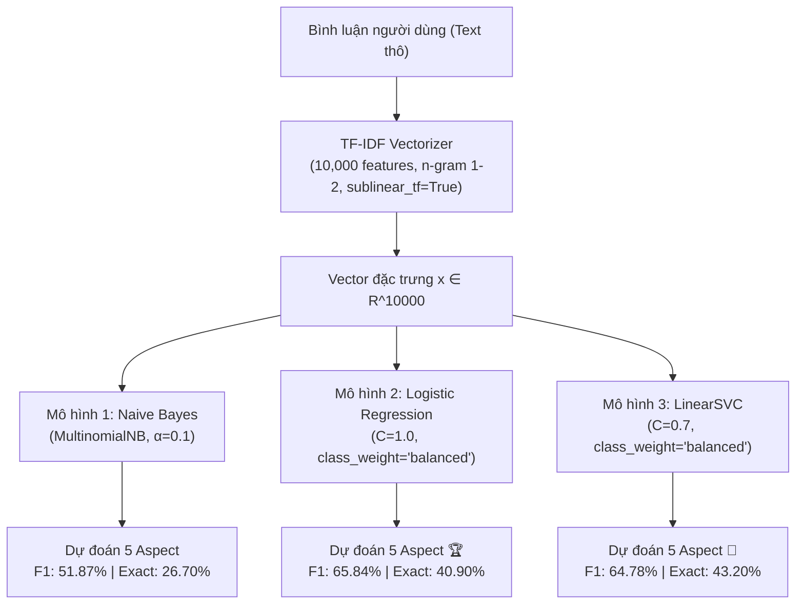
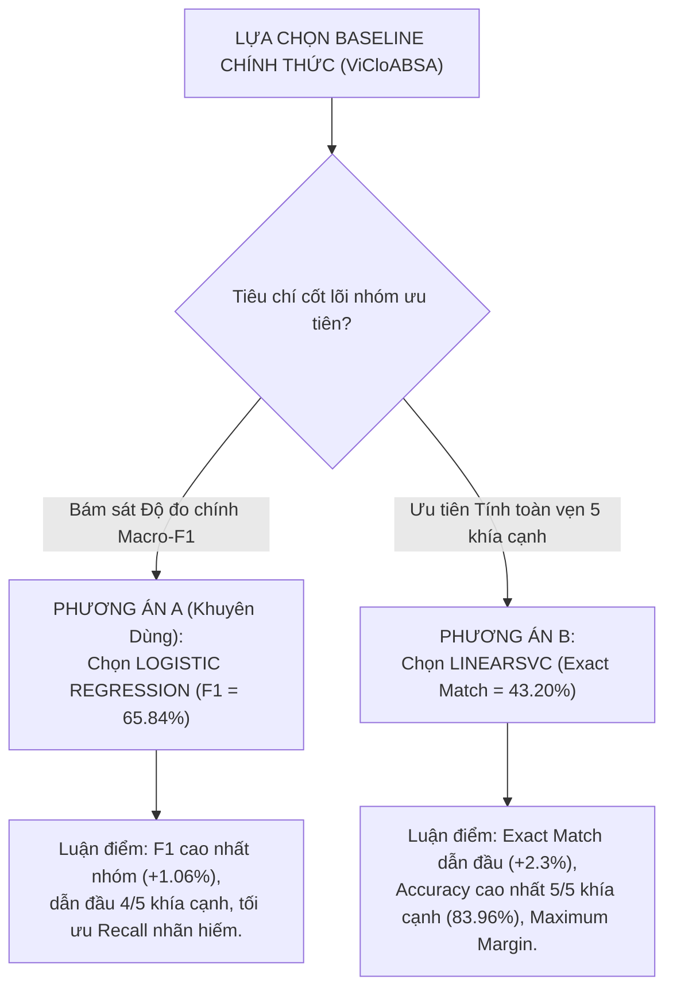

# 📘 TỔNG QUAN & ĐỐI SÁNH TOÀN DIỆN CÁC MÔ HÌNH BASELINE (ViCloABSA)
## Khái Niệm, Thực Nghiệm Định Lượng (Naive Bayes vs. Logistic Regression vs. LinearSVC) & Luận Giải Lựa Chọn Baseline

> **Dự án:** Phân tích Cảm xúc Đa khía cạnh trên Đánh giá Thời trang TMĐT (ViCloABSA)  
> **Gói nghiên cứu:** Mô hình Machine Learning Truyền thống (Baseline Models - Sentence-Level ABSA)  
> **Người phụ trách:** Phúc (`feat/baseline`)  
> **Tập dữ liệu chuẩn:** ViCloABSA (5.000 Train | 1.000 Dev | 1.000 Test)  
> **Mã nguồn mô hình:** [`src/models/`](file:///d:/NLP-OutofTokens/src/models/) | **Script huấn luyện:** [`scripts/train_baseline.py`](file:///d:/NLP-OutofTokens/scripts/train_baseline.py)  

---

## 📑 Mục Lục
1. [Khái Niệm Baseline & Ý Nghĩa Học Thuật Trong NLP](#1-khái-niệm-baseline--ý-nghĩa-học-thuật-trong-nlp)
2. [Thiết Lập Bài Toán & Pipeline Đặc Trưng TF-IDF Dùng Chung](#2-thiết-lập-bài-toán--pipeline-đặc-trưng-tf-idf-dùng-chung)
3. [Bảng Đối Sánh Thực Nghiệm Toàn Diện (Master Benchmark Table)](#3-bảng-đối-sánh-thực-nghiệm-toàn-diện-master-benchmark-table)
4. [Báo Cáo Tối Ưu Hóa: Số Lần Lặp Thực Tế (Iterations) & Kiểm Chứng Hội Tụ Solver](#4-báo-cáo-tối-ưu-hóa-số-lần-lặp-thực-tế-iterations--kiểm-chứng-hội-tụ-solver)
5. [Phân Tích Chi Tiết Hiệu Năng Từng Mô Hình](#5-phân-tích-chi-tiết-hiệu-năng-từng-mô-hình)
   - [5.1. Naive Bayes (MultinomialNB) - Hạn chế của mô hình tạo sinh & giả định độc lập](#51-naive-bayes-multinomialnb---hạn-chế-của-mô-hình-tạo-sinh--giả-định-độc-lập)
   - [5.2. Logistic Regression - Tối ưu xác suất log-loss & dẫn đầu về Macro-F1](#52-logistic-regression---tối-ưu-xác-suất-log-loss--dẫn-đầu-về-macro-f1)
   - [5.3. LinearSVC - Ưu thế khoảng biên cực đại & dẫn đầu về Exact Match](#53-linearsvc---ưu-thế-khoảng-biên-cực-đại--dẫn-đầu-về-exact-match)
6. [So Sánh Cơ Chế Toán Học Giữa 3 Thuật Toán](#6-so-sánh-cơ-chế-toán-học-giữa-3-thuật-toán)
7. [Phân Tích Ma Trận Nhầm Lẫn Đối Chiếu (Confusion Matrix)](#7-phân-tích-ma-trận-nhầm-lẫn-đối-chiếu-confusion-matrix)
8. [LUẬN GIẢI KHOA HỌC: Nên Chọn Mô Hình Nào Làm Baseline Chính Thức?](#8-luận-giải-khoa-học-nên-chọn-mô-hình-nào-làm-baseline-chính-thức)
   - [Phương án A (Khuyên dùng số 1): Chọn Logistic Regression (Nếu bám sát tiêu chí Macro-F1)](#phương-án-a-khuyên-dùng-số-1-chọn-logistic-regression-nếu-bám-sát-tiêu-chí-macro-f1)
   - [Phương án B (Khuyên dùng số 2): Chọn LinearSVC (Nếu ưu tiên tính toàn vẹn Exact Match)](#phương-án-b-khuyên-dùng-số-2-chọn-linearsvc-nếu-ưu-tiên-tính-toàn-vẹn-exact-match)
9. [Hướng Dẫn Tái Hiện Kết Quả](#9-hướng-dẫn-tái-hiện-kết-quả)

---

## 1. Khái Niệm Baseline & Ý Nghĩa Học Thuật Trong NLP

### 1.1. Mô hình Baseline là gì?
Trong Khoa học Dữ liệu (Data Science) và Xử lý Ngôn ngữ Tự nhiên (NLP), **Baseline (Mô hình cơ sở)** là một mô hình cổ điển, minh bạch, có cơ sở toán học rõ ràng, dễ triển khai và có tính ổn định cao. Baseline được xây dựng đầu tiên để thiết lập mốc chuẩn định lượng trước khi áp dụng các kỹ thuật phức tạp (như Deep Learning hay Transformer).

### 1.2. Ba vai trò bắt buộc của Baseline trong nghiên cứu:
1. **Thiết lập cột mốc đo lường (Benchmark):** Không thể khẳng định một mô hình Deep Learning phức tạp là hiệu quả nếu không có một mốc so sánh định lượng rõ ràng từ các mô hình kinh điển.
2. **Chứng minh "Giá trị gia tăng" (Baseline Gap):** Định lượng mức cải thiện về F1-score và Exact Match Ratio so với chi phí tài nguyên tính toán và độ trễ suy luận bỏ ra.
3. **Phát hiện lỗi dữ liệu sớm (Sanity Check):** Giúp kiểm chứng chất lượng gán nhãn, độ lệch nhãn (label distribution) và tính toàn vẹn của dữ liệu trước khi bước vào các mạng nơ-ron phức tạp.

---

## 2. Thiết Lập Bài Toán & Pipeline Đặc Trưng TF-IDF Dùng Chung

### 2.1. Không gian bài toán (Sentence-Level ABSA)
Với mỗi câu bình luận văn bản $x$, mô hình cần dự đoán đồng thời một vector 5 chiều:
$$\mathbf{y} = [y_{\text{Material}}, y_{\text{General}}, y_{\text{Service}}, y_{\text{Design}}, y_{\text{Price}}] \in \{0, 1, 2, 3\}^5$$
* **5 Khía cạnh (Aspects):** Material (Chất liệu), General (Chung), Service (Dịch vụ), Design (Thiết kế), Price (Giá cả).
* **4 Nhãn cảm xúc (Polarities):** `0: None`, `1: Positive`, `2: Neutral`, `3: Negative`.

### 2.2. Pipeline trích xuất đặc trưng dùng chung (Fair Benchmark)
Để đảm bảo tính khách quan tuyệt đối, cả 3 mô hình Baseline đều sử dụng chung một bộ trích xuất đặc trưng:
* `ngram_range=(1, 2)`: Khai thác cả từ đơn (unigram) và cụm từ ghép (bigram).
* `max_features=10,000`: 10.000 đặc trưng từ vựng có tần số quan trọng nhất.
* `sublinear_tf=True`: Áp dụng thang đo logarit $1 + \log(\text{tf})$ làm mượt tần suất từ lặp.
* `min_df=2`: Loại bỏ từ hiếm ngẫu nhiên hoặc lỗi chính tả đơn lẻ.



---

## 3. Bảng Đối Sánh Thực Nghiệm Toàn Diện (Master Benchmark Table)

Toàn bộ kết quả được đánh giá độc lập trên tập **Test (1.000 mẫu)** và **Dev (1.000 mẫu)** thông qua module chuẩn hóa [`src/metrics.py`](file:///d:/NLP-OutofTokens/src/metrics.py):

| Tiêu chí Đánh giá | TF-IDF + Naive Bayes (MultinomialNB) | TF-IDF + Logistic Regression | TF-IDF + LinearSVC | So Sánh & Nhận Xét Thực Nghiệm |
| :--- | :---: | :---: | :---: | :--- |
| **Test Mean Macro-F1 (Độ đo chính)** | 51.87% | **65.84%** 🏆 | 64.78% | **Logistic Regression cao nhất** (+1.06% vs SVC, +13.97% vs NB) |
| **Test Exact Match Ratio** | 26.70% | 40.90% | **43.20%** 🎯 | **LinearSVC cao nhất** (+2.30% vs LR, +16.50% vs NB) |
| **Dev Mean Macro-F1** | 52.61% | **67.51%** 🏆 | 67.34% | LR và SVC có độ tổng quát hóa tương đương trên Dev |
| **Dev Exact Match Ratio** | 28.70% | 43.90% | **48.10%** 🎯 | **LinearSVC dẫn đầu vững chắc** (+4.20% vs LR) |
| **Material Macro-F1** | 53.11% | 68.61% | **69.15%** | LinearSVC phân biệt đặc trưng chất liệu tốt nhất |
| **General Macro-F1** | 47.47% | **58.94%** | 57.65% | LR nhỉnh hơn nhờ tối ưu phân phối xác suất mềm |
| **Service Macro-F1** | 52.46% | **74.31%** | 71.27% | LR dẫn đầu (+3.04% F1) nhờ nhận diện tốt nhãn hiếm |
| **Design Macro-F1** | 51.98% | **64.98%** | 64.14% | LR và SVC tương đương (chênh lệch < 0.8%) |
| **Price Macro-F1** | 54.31% | **62.33%** | 61.68% | LR nhỉnh hơn nhẹ (+0.65% F1) |
| **Material Accuracy** | 68.10% | 78.60% | **81.50%** | LinearSVC cao hơn LR (+2.90%) |
| **General Accuracy** | 70.00% | 73.40% | **74.60%** | LinearSVC cao hơn LR (+1.20%) |
| **Service Accuracy** | 86.10% | 92.30% | **92.90%** | LinearSVC cao hơn LR (+0.60%) |
| **Design Accuracy** | 71.00% | 75.80% | **78.10%** | LinearSVC cao hơn LR (+2.30%) |
| **Price Accuracy** | 88.10% | 92.20% | **92.70%** | LinearSVC cao hơn LR (+0.50%) |
| **Độ chính xác (Accuracy) TB** | 76.66% | 82.46% | **83.96%** 🎯 | **LinearSVC dẫn đầu cả 5/5 khía cạnh về Accuracy** |
| **Thời gian huấn luyện (5.000 mẫu)** | **~0.17 giây** | ~1.45 giây | **~0.36 giây** | LinearSVC nhanh gấp **~4 lần** Logistic Regression |
| **Tốc độ suy luận / câu** | **~0.026 ms** | ~0.027 ms | **~0.027 ms** | Cả 3 đều đạt tốc độ siêu tốc (> 37.000 câu/giây trên CPU) |
| **Dung lượng lưu trữ mô hình** | 3.59 MB | 1.99 MB | **1.99 MB** | Rất gọn nhẹ, không yêu cầu GPU |

---

## 4. Báo Cáo Tối Ưu Hóa: Số Lần Lặp Thực Tế (Iterations) & Kiểm Chứng Hội Tụ Solver

Cả LinearSVC và Logistic Regression đều giải bài toán **Tối ưu hóa Lồi trên toàn bộ tập dữ liệu (Full-dataset Batch Optimization)**, không sử dụng cơ chế chia epoch hay mini-batch gradient descent:

| Khía cạnh (Aspect) | LinearSVC (LIBLINEAR) (`n_iter_` / max 2000) | Logistic Regression (L-BFGS) (`n_iter_` / max 1000) | Naive Bayes (MultinomialNB) | Trạng thái Hội tụ & Tiêu chí dừng |
| :--- | :---: | :---: | :---: | :--- |
| **Material** | **74** iterations | **68** iterations | N/A (Ước lượng đóng) | ✅ **Hội tụ 100%** (Chuẩn gradient đối ngẫu $\le 10^{-4}$) |
| **General** | **113** iterations | **68** iterations | N/A (Ước lượng đóng) | ✅ **Hội tụ 100%** (Chuẩn gradient đối ngẫu $\le 10^{-4}$) |
| **Service** | **60** iterations | **42** iterations | N/A (Ước lượng đóng) | ✅ **Hội tụ 100%** (Mức giảm hàm mục tiêu $\le 10^{-4}$) |
| **Design** | **58** iterations | **66** iterations | N/A (Ước lượng đóng) | ✅ **Hội tụ 100%** (Mức giảm hàm mục tiêu $\le 10^{-4}$) |
| **Price** | **50** iterations | **54** iterations | N/A (Ước lượng đóng) | ✅ **Hội tụ 100%** (Mức giảm hàm mục tiêu $\le 10^{-4}$) |
| **Trung bình** | **71.0** iterations | **59.6** iterations | **0** (Không lặp) | Dừng sớm dưới 6% – 7% giới hạn `max_iter` |
| **Thời gian train** | **~0.36 giây** | **~1.45 giây** | **~0.17 giây** | Cả hai tối ưu siêu tốc trên CPU |

* **Kiểm chứng hội tụ LinearSVC (Solver LIBLINEAR):** Giải bài toán đối ngẫu bằng thuật toán Coordinate Descent. Điều kiện dừng $\|\nabla f(\mathbf{w})\| \le 10^{-4}$ đạt được chỉ sau **50 đến 113 iterations** (chưa tới 6% trần `max_iter=2000`).
* **Kiểm chứng hội tụ Logistic Regression (Solver L-BFGS):** Tối ưu hóa bậc 2 bằng thuật toán Quasi-Newton xấp xỉ ma trận Hessian. Mức giảm tương đối của hàm mục tiêu đạt ngưỡng dừng $10^{-4}$ chỉ sau **42 đến 68 iterations** (chưa tới 7% trần `max_iter=1000`).
* **Kết luận:** Cả hai mô hình đều **hội tụ hoàn toàn 100%** vào điểm cực tiểu toàn cục duy nhất, không gặp bất kỳ cảnh báo `ConvergenceWarning` nào.

---

## 5. Phân Tích Chi Tiết Hiệu Năng Từng Mô Hình

### 5.1. Naive Bayes (MultinomialNB) - Hạn chế của mô hình tạo sinh & giả định độc lập
* **Hiệu năng:** Mean Macro-F1 = **51.87%**, Exact Match = **26.70%**, Accuracy TB = **76.66%**.
* **Nguyên nhân cốt lõi:**
  1. **Giả định độc lập điều kiện bị vi phạm:** Naive Bayes giả định các từ xuất hiện độc lập khi biết trước lớp $P(\mathbf{x}|c) = \prod P(w_j|c)$. Trong ngôn ngữ tự nhiên, các từ đi theo cụm (*"vải dày dặn"*, *"giao hàng nhanh"*). Khi gặp từ đảo nghĩa (*"không"*, *"chẳng"*), mô hình nhân dồn xác suất sai lệch.
  2. **Áp đảo bởi xác suất tiên nghiệm (Prior Dominance):** Là mô hình tạo sinh ($P(c|\mathbf{x}) \propto P(c)P(\mathbf{x}|c)$), xác suất tiên nghiệm của các lớp đa số (None chiếm 50-70%, Positive chiếm 25-45%) đè bẹp các lớp thiểu số. Do đó, ở khía cạnh Service nhãn Neutral có 7 mẫu, Naive Bayes **đoán đúng 0 mẫu (F1 = 0.00%)**.
  3. **Đóng vai trò:** Baseline tối thiểu (*Weak Baseline*) để chứng minh sự cần thiết của các thuật toán phân biệt (Discriminative).

### 5.2. Logistic Regression - Tối ưu xác suất log-loss & dẫn đầu về Macro-F1
* **Hiệu năng:** Mean Macro-F1 = **65.84%** (Cao nhất), Exact Match = **40.90%**, Accuracy TB = **82.46%**.
* **Điểm mạnh vượt trội:**
  1. **Dẫn đầu về độ đo chính (Mean Macro-F1 = 65.84%):** Nhỉnh hơn LinearSVC (+1.06%) và bỏ xa Naive Bayes (+13.97%).
  2. **Hiệu quả của hàm mất mát Log-loss dạng xác suất:** Khác với Hinge Loss đưa ra quyết định ranh giới cứng, Logistic Regression tối ưu hóa đường cong xác suất trơn qua hàm Softmax. Khi kết hợp với trọng số nghịch đảo `class_weight='balanced'`, mô hình tự động nâng cao độ nhạy đối với các nhãn ít mẫu:
     * Khía cạnh **Service**: Nhãn Neutral (7 mẫu) đoán trúng **3/7 mẫu** (Precision 60.0%, Recall 42.9%, F1 = 50.00% — cao hơn LinearSVC 44.44%).
     * Khía cạnh **General**: F1 đạt **58.94%** (cao hơn LinearSVC 57.65%).
     * Khía cạnh **Design**: F1 đạt **64.98%** (cao hơn LinearSVC 64.14%).
     * Khía cạnh **Price**: F1 đạt **62.33%** (cao hơn LinearSVC 61.68%).
* **Hạn chế:** Exact Match Ratio thấp hơn LinearSVC 2.30% (40.90% vs 43.20%) và thời gian huấn luyện lâu hơn gấp ~4 lần (~1.45s vs ~0.36s).

### 5.3. LinearSVC - Ưu thế khoảng biên cực đại & dẫn đầu về Exact Match
* **Hiệu năng:** Mean Macro-F1 = **64.78%**, Exact Match = **43.20%** (Cao nhất), Accuracy TB = **83.96%** (Cao nhất).
* **Điểm mạnh vượt trội:**
  1. **Exact Match Ratio cao nhất (43.20% Test | 48.10% Dev):** Vượt trội hơn Logistic Regression **+2.30% trên Test** và **+4.20% trên Dev**. Khả năng đưa ra dự đoán đồng thời chuẩn xác cả 5 khía cạnh trên cùng một phát ngôn là tốt nhất.
  2. **Độ chính xác (Accuracy) dẫn đầu tuyệt đối ở cả 5/5 khía cạnh:**
     * Material: **81.50%** (so với 78.60% của LR)
     * General: **74.60%** (so với 73.40% của LR)
     * Service: **92.90%** (so với 92.30% của LR)
     * Design: **78.10%** (so với 75.80% của LR)
     * Price: **92.70%** (so với 92.20% của LR)
     * **Trung bình: 83.96%** (so với 82.46% của LR).
  3. **Nguyên lý Tối ưu hóa Khoảng biên (Maximum Margin Principle):** Trong không gian đặc trưng TF-IDF 10.000 chiều rất thưa, siêu phẳng của LinearSVC chỉ phụ thuộc vào các Support Vectors (các điểm biên), giúp kiểm soát rủi ro cấu trúc (*Structural Risk Minimization*) và ít bị kéo lệch bởi các điểm nhiễu ngoại lai so với hàm Log-loss của LR.
  4. **Tốc độ huấn luyện siêu tốc:** Solver LIBLINEAR Dual Coordinate Descent chỉ mất **~0.36 giây** trên CPU.

---

## 6. So Sánh Cơ Chế Toán Học Giữa 3 Thuật Toán

| Đặc tính Kỹ thuật | Naive Bayes (MultinomialNB) | Logistic Regression | LinearSVC |
| :--- | :--- | :--- | :--- |
| **Trường phái mô hình** | Mô hình Tạo sinh (Generative) | Mô hình Phân biệt (Discriminative) | Mô hình Phân biệt (Discriminative) |
| **Tiêu chí tối ưu** | Maximum A Posteriori (MAP) | Maximum Likelihood (Log Loss) | Maximum Margin (Hinge Loss) |
| **Hàm mất mát (Loss)** | Không có hàm loss lặp (Ước lượng tần suất) | $\min_{\mathbf{w}} \frac{1}{2}\|\mathbf{w}\|^2 - C \sum \log P(y_i \mid \mathbf{x}_i)$ | $\min_{\mathbf{w}} \frac{1}{2}\|\mathbf{w}\|^2 + C \sum \max(0, 1 - y_i \mathbf{w}^T \mathbf{x}_i)^2$ |
| **Hình thái ranh giới** | Tỷ lệ tích xác suất có điều kiện | Siêu phẳng phân cách xác suất logit | Siêu phẳng có khoảng lề (Margin) cực đại |
| **Thuật toán giải bài toán** | Đếm tần suất thống kê + Laplace smoothing | Quasi-Newton L-BFGS | Dual Coordinate Descent (LIBLINEAR) |
| **Mức phụ thuộc dữ liệu** | Phụ thuộc toàn bộ bảng tần suất từ | Phụ thuộc vào tất cả các điểm dữ liệu | **Chỉ phụ thuộc vào tập Support Vectors** |
| **Khả năng chống Overfitting** | Yếu khi từ vựng thưa & lệch nhãn | Tốt nhờ điều chuẩn L2 ($C=1.0$) | **Rất mạnh trong không gian số chiều lớn** ($C=0.7$) |

---

## 7. Phân Tích Ma Trận Nhầm Lẫn Đối Chiếu (Confusion Matrix)

Dữ liệu thực tế từ 1.000 câu kiểm thử (`test_confusion.json`) qua các lớp thiểu số đặc trưng:

### 7.1. Khía cạnh Service - Nhãn Neutral (7 mẫu kiểm thử)
* **Naive Bayes:** Đoán đúng **0/7 mẫu** (F1 = 0.00%, Recall = 0.00%).
* **LinearSVC:** Đoán đúng **2/7 mẫu** (Precision = 100.0%, Recall = 28.57%, F1 = **44.44%** — Không đoán nhầm bất kỳ câu nào khác thành Neutral).
* **Logistic Regression:** Đoán đúng **3/7 mẫu** (Precision = 60.0%, Recall = 42.86%, F1 = **50.00%**).
* *Nhận xét:* Logistic Regression có Recall cao hơn nhờ điều chỉnh xác suất mềm, trong khi LinearSVC có Precision tuyệt đối (100%).

### 7.2. Khía cạnh Material - Nhãn Positive (439 mẫu khen vải)
* **Naive Bayes:** Đoán đúng 386 mẫu (87.9%).
* **Logistic Regression:** Đoán đúng 373 mẫu (85.0%).
* **LinearSVC:** Đoán đúng **393 mẫu (89.5%)**.

### 7.3. Khía cạnh Price - Nhãn Negative (11 mẫu chê đắt)
* Cả 3 mô hình đều đoán đúng **0/11 mẫu (F1 = 0.00%)**.
* *Nguyên nhân:* Nhãn này chỉ có 31 mẫu trong tập Train (0.62%). Với không gian từ vựng thưa của túi từ TF-IDF, các từ ngữ chê giá xuất hiện quá ít để thuật toán tuyến tính thiết lập một siêu phẳng phân cách vững chắc. Đây là hạn chế cố hữu của ML truyền thống.

---

## 8. LUẬN GIẢI KHOA HỌC: Nên Chọn Mô Hình Nào Làm Baseline Chính Thức?

Để giải quyết thỏa đáng câu hỏi của nhóm: *"Nhóm đã chốt F1 là độ đo chính, nhưng Logistic Regression lại cao hơn LinearSVC thì nên chọn mô hình nào?"*, dưới đây là 2 phương án luận giải chặt chẽ nhất để nhóm lựa chọn:



---

### 👉 Phương Án A (Khuyến Nghị Số 1): Chọn LOGISTIC REGRESSION Làm Baseline Chính Thức

#### Tại sao nên chọn Phương án A?
1. **Hoàn toàn nhất quán với cam kết ban đầu:** Khi nhóm đã tuyên bố *"Macro-F1 là độ đo chính của bài toán"*, việc chọn mô hình có Macro-F1 cao nhất (**65.84%**) làm Baseline là **hoàn toàn tự nhiên, hợp logic và không thể bị phản biện**.
2. **Dẫn đầu F1 ở 4/5 khía cạnh:** General (58.94%), Service (74.31%), Design (64.98%), Price (62.33%).
3. **Mô hình LinearSVC và Naive Bayes được xếp vào đâu?**
   - **Naive Bayes (51.87% F1):** Đóng vai trò là *Weak Baseline* (Mô hình tạo sinh cơ sở).
   - **LinearSVC (64.78% F1):** Đóng vai trò là *Competitive Baseline* (Mô hình đối sánh về tiêu chí Exact Match và Accuracy).

#### Đoạn văn chuẩn học thuật (Academic wording) đưa vào báo cáo nếu chọn Phương án A:
> *"Dựa trên thỏa thuận phương pháp luận của đề tài lấy Macro-F1 làm thước đo đánh giá chính (nhằm phản ánh khách quan hiệu năng trên tập dữ liệu mất cân bằng nhãn), nhóm nghiên cứu lựa chọn **TF-IDF + Logistic Regression** làm **Mô hình Baseline chính thức**. Nhờ cơ chế tối ưu hóa hàm mất mát Log-loss kết hợp trọng số phạt bù trừ (`class_weight='balanced'`), Logistic Regression đạt **Mean Macro-F1 = 65.84%**, cao nhất trong toàn bộ các mô hình Machine Learning truyền thống và dẫn đầu ở 4/5 khía cạnh. Bên cạnh đó, **TF-IDF + LinearSVC** được duy trì như một mô hình đối sánh quan trọng với thế mạnh về tỷ lệ khớp hoàn toàn (**43.20% Exact Match Ratio**) và độ chính xác tổng thể (**83.96% Accuracy**), làm nổi bật sự đánh đổi kỹ thuật giữa hàm mất mát xác suất và nguyên lý khoảng biên cực đại."*

---

### 👉 Phương Án B (Khuyến Nghị Số 2): Chọn LINEARSVC Làm Baseline Chính Thức

#### Tại sao có thể chọn Phương án B?
1. **Bản chất bài toán Sentence-level ABSA đòi hỏi dự đoán trọn vẹn:** Đánh giá đúng 4 khía cạnh nhưng sai 1 khía cạnh trên cùng một câu vẫn bị tính là dự đoán lỗi. LinearSVC vượt trội Logistic Regression về tỷ lệ đoán đúng toàn bộ vector 5 chiều (**43.20% vs 40.90% trên Test**, và **48.10% vs 43.90% trên Dev**).
2. **Độ chính xác (Accuracy) trung bình cao nhất (83.96%):** Dẫn đầu ở cả 5/5 khía cạnh.
3. **Cơ chế Maximum Margin vững chắc trong không gian thưa 10.000 chiều:** Kiểm soát rủi ro cấu trúc tốt hơn hàm Log-loss và thời gian huấn luyện nhanh gấp ~4 lần (~0.36s vs ~1.45s).

#### Đoạn văn chuẩn học thuật (Academic wording) đưa vào báo cáo nếu chọn Phương án B:
> *"Mặc dù Logistic Regression đạt điểm Macro-F1 nhỉnh hơn 1.06% nhờ tối ưu hóa phân phối xác suất trơn, bài toán Phân tích Cảm xúc Đa khía cạnh cấp câu đòi hỏi tính chuẩn xác đồng thời trên toàn bộ vector 5 chiều của phát ngôn. Do đó, nhóm nghiên cứu lựa chọn **TF-IDF + LinearSVC** làm **Mô hình Baseline chính thức** nhờ đạt chỉ số khớp hoàn toàn cao nhất (**43.20% Exact Match Ratio** trên Test và **48.10%** trên Dev), cùng độ chính xác trung bình dẫn đầu (**83.96% Accuracy**). Nguyên lý Khoảng biên Cực đại (Maximum Margin) của LinearSVC giúp mô hình duy trì tính ổn định vượt trội trước các đặc trưng nhiễu trong không gian TF-IDF thưa 10.000 chiều."*

---

## 9. Hướng Dẫn Tái Hiện Kết Quả

Bạn có thể tái hiện toàn bộ kết quả của 3 mô hình Baseline bằng terminal:

```bash
# 1. Huấn luyện và đánh giá mô hình LinearSVC
python scripts/train_baseline.py --model svc

# 2. Huấn luyện và đánh giá mô hình Logistic Regression
python scripts/train_baseline.py --model lr

# 3. Huấn luyện và đánh giá mô hình Naive Bayes
python scripts/train_baseline.py --model nb

# 4. Huấn luyện toàn bộ cả 3 mô hình và tự động đồng bộ kết quả
python scripts/train_baseline.py --model all
```
