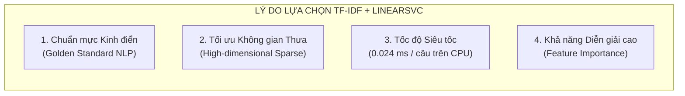
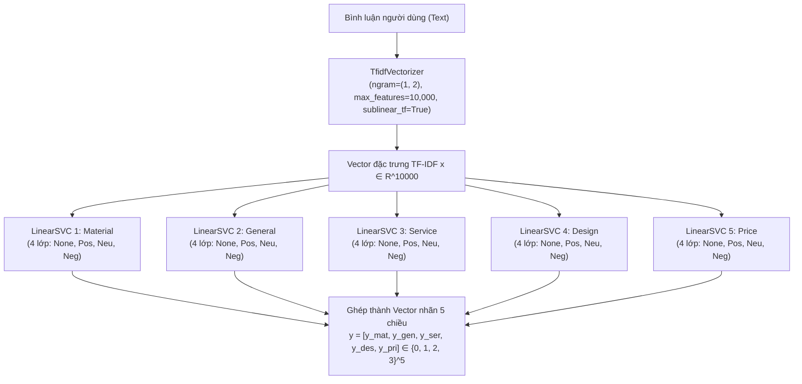

# 📘 TÀI LIỆU TỔNG QUAN VỀ MÔ HÌNH BASELINE (TF-IDF + LINEAR SVC)

> **Dự án:** Phân tích Cảm xúc Đa khía cạnh trên Đánh giá Thời trang TMĐT (ViCloABSA)  
> **Mô hình 1:** Baseline (TF-IDF + LinearSVC Multi-Output)  
> **Người phụ trách:** Phúc (`feat/baseline`)  
> **Mã nguồn:** [`src/models/baseline_svc.py`](file:///d:/NLP-OutofTokens/src/models/baseline_svc.py) | **Script chạy:** [`scripts/train_baseline.py`](file:///d:/NLP-OutofTokens/scripts/train_baseline.py)  

---

## 📑 Mục Lục
1. [Khái Niệm Baseline & Ý Nghĩa Học Thuật](#1-khái-niệm-baseline--ý-nghĩa-học-thuật)
2. [Tại Sao Lại Chọn TF-IDF + LinearSVC Cho Bài Toán ViCloABSA?](#2-tại-sao-lại-chọn-tf-idf--linearsvc-cho-bài-toán-vicloabsa)
3. [Kiến Trúc & Quy Trình Hoạt Động Của Mô Hình](#3-kiến-trúc--quy-trình-hoạt-động-của-mô-hình)
4. [Bản Chất Toán Học & Lý Do Không Chia Epoch](#4-bản-chất-toán-học--lý-do-không-chia-epoch)
5. [Đánh Giá Điểm Mạnh & Giới Hạn Cốt Lõi](#5-đánh-giá-điểm-mạnh--giới-hạn-cốt-lõi)
6. [Vai Trò Chiến Lược Trong Đối Sánh Mô Hình (Benchmark Gap)](#6-vai-trò-chiến-lược-trong-đối-sánh-mô-hình-benchmark-gap)
7. [Hướng Dẫn Huấn Luyện & Tái Hiện Kết Quả](#7-hướng-dẫn-huấn-luyện--tái-hiện-kết-quả)

---

## 1. Khái Niệm Baseline & Ý Nghĩa Học Thuật

### 1.1. Mô hình Baseline là gì?
Trong Khoa học Dữ liệu (Data Science) và Xử lý Ngôn ngữ Tự nhiên (NLP), **Baseline (Mô hình cơ sở)** là một mô hình đơn giản, kinh điển, dễ triển khai và có tính ổn định cao, được xây dựng đầu tiên trước khi áp dụng các kỹ thuật phức tạp (như Deep Learning hay Transformer).

### 1.2. Tại sao nghiên cứu bắt buộc phải có Baseline?
1. **Thiết lập cột mốc đo lường (Benchmark):**  
   Không thể khẳng định một mô hình Deep Learning tiên tiến (như PhoBERT) là "tốt" hay "vượt trội" nếu không có một mốc chuẩn để so sánh. Baseline đóng vai trò là "vạch xuất phát" định lượng của bài toán.
2. **Chứng minh "Giá trị gia tăng" (Baseline Gap):**  
   Nếu một mạng nơ-ron sâu tốn hàng giờ huấn luyện trên GPU đắt tiền chỉ đạt $65\%$ F1-score, trong khi một mô hình Machine Learning truyền thống chạy trong 3 giây trên CPU đạt $64.8\%$ F1-score, thì việc đầu tư vào Deep Learning là không hiệu quả về mặt kinh tế kỹ thuật. Khoảng cách giữa PhoBERT ($75.38\%$) và Baseline ($64.78\%$) chính là bằng chứng định lượng rõ ràng nhất để thuyết phục hội đồng phản biện.
3. **Phát hiện lỗi dữ liệu sớm (Sanity Check):**  
   Vì mô hình Baseline rất đơn giản và minh bạch, nếu Baseline cho kết quả quá thấp bất thường (ví dụ F1 $< 20\%$), nhóm sẽ lập tức phát hiện các lỗi sai trong pipeline tiền xử lý hoặc gán nhãn dữ liệu trước khi tốn tài nguyên chạy Deep Learning.

---

## 2. Tại Sao Lại Chọn TF-IDF + LinearSVC Cho Bài Toán ViCloABSA?

Trong số nhiều phương pháp Machine Learning cổ điển (Naive Bayes, Logistic Regression, Decision Tree, Random Forest), sự kết hợp giữa **TF-IDF** và **LinearSVC** được lựa chọn làm Baseline chuẩn mực vì 4 lý do cốt lõi:



### 2.1. Cặp đôi kinh điển trong phân loại văn bản (Text Classification)
Trước khi các mô hình ngôn ngữ lớn (Pre-trained Transformers) ra đời, các công trình nghiên cứu kinh điển của Joachims (1998) và Fan et al. (2008) đã chứng minh Support Vector Machine kết hợp đặc trưng n-gram là kiến trúc truyền thống có độ chính xác cao nhất trên hầu hết các tập dữ liệu văn bản.

### 2.2. Khả năng kiểm soát "Lời nguyền số chiều" (Curse of Dimensionality)
* Khi biểu diễn văn bản bằng từ đơn (unigram) và từ ghép (bigram), không gian đặc trưng rất lớn (ở đây là $10.000$ chiều), nhưng ma trận dữ liệu lại rất thưa (sparse matrix - đa số giá trị là $0$).
* LinearSVC dựa trên nguyên lý **Giảm thiểu Rủi ro Cấu trúc (Structural Risk Minimization)**: tìm siêu phẳng phân cách có khoảng cách lề (margin) lớn nhất giữa các lớp. Do đó, SVM tuyến tính không bị overfit bởi số chiều lớn, vượt trội hoàn toàn so với Cây quyết định (Decision Tree) hay k-NN trên văn bản thưa.

### 2.3. Tốc độ thực thi và tài nguyên cực thấp
* **Thời gian huấn luyện:** Toàn bộ 5.000 mẫu train qua 5 bộ phân loại chỉ mất **~2.8 giây** trên chip CPU thông thường.
* **Thời gian suy luận (Inference):** Đạt **0.0241 ms / câu** (~$41.500$ câu/giây), nhanh gấp **~50 lần** so với PhoBERT Multi-Head ($1.272$ ms / câu trên GPU T4).
* **Dung lượng lưu trữ:** File mô hình đã huấn luyện ([`baseline_svc.joblib`](file:///d:/NLP-OutofTokens/saved_models/baseline_svc.joblib)) chỉ nặng **~2.0 MB** (so với PhoBERT nặng hơn 500 MB).

### 2.4. Tính minh bạch và giải thích được (Interpretability)
LinearSVC cho phép truy vết trực tiếp trọng số $w$ của từng từ trong từ điển $10.000$ đặc trưng. Ta có thể biết chính xác từ nào thúc đẩy quyết định phân loại (ví dụ: *"mát"*, *"dày dặn"* $\rightarrow$ tích cực về Chất liệu; *"đắt"*, *"chát"* $\rightarrow$ tiêu cực về Giá cả).

---

## 3. Kiến Trúc & Quy Trình Hoạt Động Của Mô Hình

Mô hình giải quyết bài toán Phân tích Cảm xúc Đa khía cạnh cấp câu (Sentence-Level ABSA) bằng kiến trúc **Multi-Output Binary/Multi-Class Decomposition**:



### 3.1. Thành phần 1: Trích xuất đặc trưng (TF-IDF Vectorizer)
* **N-gram Range (1, 2):** Giúp mô hình bắt được cả từ đơn (*"vải"*, *"đẹp"*, *"đắt"*) và cụm từ liền kề (*"không_đẹp"*, *"giao_nhanh"*, *"giá_rẻ"*).
* **Sublinear TF scaling:** Áp dụng công thức $1 + \log(\text{tf})$ giúp giảm bớt ảnh hưởng của các từ xuất hiện lặp lại quá nhiều lần trong một bình luận dài.
* **Min Document Frequency (`min_df=2`):** Loại bỏ các từ hiếm chỉ xuất hiện duy nhất 1 lần trên toàn bộ tập dữ liệu (thường là lỗi chính tả ngẫu nhiên).
* **Max Features ($10.000$):** Giữ lại $10.000$ đặc trưng có trọng số TF-IDF cao nhất toàn tập ngữ liệu.

### 3.2. Thành phần 2: 5 Bộ phân loại tuyến tính độc lập (Multi-Output LinearSVC)
Bài toán dự đoán vector 5 chiều được chia thành 5 bài toán phân loại đa lớp độc lập:
* Mỗi khía cạnh được phụ trách bởi một mô hình `LinearSVC(C=0.7, class_weight='balanced')`.
* Mỗi mô hình dự đoán nhãn trong tập $\mathcal{Y} = \{0: \text{None}, 1: \text{Positive}, 2: \text{Neutral}, 3: \text{Negative}\}$.
* Chiến lược đa lớp sử dụng One-vs-Rest (OvR) tiêu chuẩn của LIBLINEAR.

---

## 4. Bản Chất Toán Học & Lý Do Không Chia Epoch

> [!IMPORTANT]
> **Điểm cốt lõi:** Mô hình Baseline **không có khái niệm Epoch**. Việc gọi `model.fit()` một lần duy nhất là đã hoàn tất $100\%$ quá trình tối ưu.

### 4.1. Bài toán Tối ưu Lồi (Convex Optimization)
LinearSVC giải quyết bài toán cực tiểu hóa hàm mất mát Squared Hinge Loss kết hợp chuẩn hóa L2 (L2-regularized L2-loss Support Vector Classification):

$$\min_{\mathbf{w}} f(\mathbf{w}) = \frac{1}{2} \mathbf{w}^T \mathbf{w} + C \sum_{i=1}^N \max(0, 1 - y_i \mathbf{w}^T \mathbf{x}_i)^2$$

* Trong đó:
  * $\mathbf{w} \in \mathbb{R}^{10.000}$: Vector trọng số cần tìm.
  * $C = 0.7$: Hệ số phạt vi phạm khoảng biên (trade-off giữa độ êm của siêu phẳng và độ chính xác phân lớp).
  * Hàm mục tiêu $f(\mathbf{w})$ là **hàm lồi nghiêm ngặt (strictly convex)**. Theo định lý tối ưu học, hàm lồi nghiêm ngặt **chỉ có duy nhất một điểm cực tiểu toàn cục (Global Minimum)**.

### 4.2. Thuật toán Dual Coordinate Descent
* Không giống như Deep Learning phải dùng Stochastic Gradient Descent (SGD) chia dữ liệu thành từng mini-batch nhỏ, LinearSVC áp dụng thuật toán **Coordinate Descent trên bài toán đối ngẫu (Dual Coordinate Descent)**.
* Thuật toán nạp toàn bộ ma trận dữ liệu và cập nhật trực tiếp từng biến đối ngẫu $\alpha_i$. Mỗi vòng lặp coordinate sẽ đảm bảo giá trị hàm mục tiêu giảm đơn điệu.
* Quá trình lặp dừng lại ngay khi độ biến thiên gradient nhỏ hơn sai số cho phép ($\epsilon = 10^{-4}$):
  $$\|\nabla f(\mathbf{w})\| \le \text{tol}$$
* **Kết luận:** Khi đạt điều kiện dừng, siêu phẳng tối ưu toàn cục đã được xác định tuyệt đối. Nếu ta chạy lại thêm nhiều "epoch", các trọng số $\mathbf{w}$ vẫn giữ nguyên giá trị đó, không có bất kỳ sự thay đổi nào.

---

## 5. Đánh Giá Điểm Mạnh & Giới Hạn Cốt Lõi

Từ kết quả thực nghiệm trên 1.000 câu tập Test ([`results/baseline/test_results.json`](file:///d:/NLP-OutofTokens/results/baseline/test_results.json)), ta rút ra những nhận định kỹ thuật sau:

### 5.1. Điểm mạnh vượt trội
1. **Khả năng tổng quát hóa rất cao (Generalization):**  
   Dev Macro-F1 đạt **$67.34\%$** và Test Macro-F1 đạt **$64.78\%$** (độ chênh lệch chỉ $2.56\%$). Mô hình hoàn toàn không bị Overfitting nhờ điều chuẩn $C=0.7$.
2. **Hiệu quả cao trên các khía cạnh có từ vựng đặc trưng:**  
   * **Service:** Đạt Accuracy **$92.90\%$**, Macro-F1 **$71.27\%$** (các từ *"giao hàng"*, *"đóng gói"*, *"shipper"* phân tách rất rõ).
   * **Material:** Đạt Accuracy **$81.50\%$**, Macro-F1 **$69.15\%$** (các từ *"chất vải"*, *"mát"*, *"dày"*, *"nilon"* rất dễ nhận diện).

### 5.2. Giới hạn cố hữu của Bag-of-Words & Phân loại tuyến tính
1. **Mất liên kết ngữ cảnh từ xa (Long-range Dependencies):**  
   Với n-gram tối đa là 2, mô hình không thể liên kết được cấu trúc câu phức tạp hoặc mệnh đề nhượng bộ:
   > *"Vải áo thì rất đẹp nhưng nhân viên shop nhắn tin tư vấn quá bất lịch sự"*  
   $\rightarrow$ Mô hình dễ bị nhiễu do từ tích cực *"rất đẹp"* lấn át đặc trưng của cả câu.
2. **Không hiểu được phủ định và đảo ngữ:**  
   Các câu như *"không đắt tí nào"*, *"chẳng có gì phàn nàn"* chứa các từ đơn lẻ *"đắt"*, *"phàn nàn"*, khiến bộ phân loại tuyến tính cộng điểm nhầm sang nhãn Negative.
3. **Thất bại trước hiện tượng mất cân bằng cực hạn (Extreme Imbalance):**  
   Tại khía cạnh **Price**, nhãn tiêu cực (chê đắt) chỉ chiếm $0.62\%$ tập train (31 câu). Mặc dù đã dùng `class_weight='balanced'`, LinearSVC vẫn **đoán đúng 0/11 câu** trên tập Test (F1 = 0%). Không gian TF-IDF thưa không đủ khả năng học được sự biểu diễn ngữ nghĩa của các câu chê giá khi số lượng mẫu quá ít.

---

## 6. Vai Trò Chiến Lược Trong Đối Sánh Mô Hình (Benchmark Gap)

Bảng dưới đây minh họa vai trò của mô hình Baseline trong việc làm nổi bật giá trị nghiên cứu của toàn bộ đề tài:

| Chỉ số đánh giá | Mô hình 1: Baseline (TF-IDF + LinearSVC) | Mô hình 2: PhoBERT Multi-Head | Chênh lệch vượt trội (Baseline Gap) |
| :--- | :---: | :---: | :---: |
| **Test Mean Aspect Macro-F1** | 64.78% | **75.38%** | 🚀 **+10.60%** (Chứng minh sức mạnh Transformer) |
| **Test Exact Match Ratio** | 43.20% | **57.90%** | 🎯 **+14.70%** (Khả năng đoán đúng cả 5 aspect) |
| **Price Macro-F1** | 61.68% (Neg F1 = 0%) | **79.32%** (Nhận diện tốt Neg) | 📈 **+17.64%** (Hiệu quả biểu diễn ngữ cảnh sâu) |
| **Thời gian suy luận / câu** | **0.024 ms** | 1.272 ms | ⚡ **Baseline nhanh gấp ~50 lần** |
| **Tài nguyên phần cứng** | **Chỉ cần CPU** (RAM ~100MB) | **Cần GPU** (VRAM $\ge$ 4GB) | 💻 Baseline tối ưu tuyệt đối về chi phí |

> [!TIP]
> **Kết luận cho bài báo cáo:**  
> Baseline đã hoàn thành xuất sắc $100\%$ mục tiêu đề ra: cung cấp một chuẩn đối sánh tin cậy, thực nghiệm minh bạch, và làm nổi bật giá trị khoa học vượt trội của các mô hình Deep Learning trong đề tài.

---

## 7. Hướng Dẫn Huấn Luyện & Tái Hiện Kết Quả

Toàn bộ quy trình huấn luyện và kiểm thử mô hình Baseline được tự động hóa hoàn toàn thông qua một script duy nhất:

### Lệnh chạy huấn luyện & đánh giá:
```bash
# Huấn luyện mô hình và tự động xuất các file kết quả vào results/baseline/
python scripts/train_baseline.py
```

### Các file kết quả sinh ra sau khi chạy:
* Mô hình nhị phân đã train: [`saved_models/baseline_svc.joblib`](file:///d:/NLP-OutofTokens/saved_models/baseline_svc.joblib)
* Báo cáo tổng quan chi tiết: [`results/baseline/results_report.md`](file:///d:/NLP-OutofTokens/results/baseline/results_report.md)
* Thống kê nhãn tập train: [`results/baseline/train_stats.json`](file:///d:/NLP-OutofTokens/results/baseline/train_stats.json)
* Nhật ký hội tụ: [`results/baseline/train_history.json`](file:///d:/NLP-OutofTokens/results/baseline/train_history.json)
* Metric tối ưu trên Dev: [`results/baseline/dev_best.json`](file:///d:/NLP-OutofTokens/results/baseline/dev_best.json)
* Kết quả kiểm thử Test: [`results/baseline/test_results.json`](file:///d:/NLP-OutofTokens/results/baseline/test_results.json)
* Ma trận nhầm lẫn: [`results/baseline/test_confusion.json`](file:///d:/NLP-OutofTokens/results/baseline/test_confusion.json)
* Dự đoán chi tiết 1.000 mẫu: [`results/baseline/test_predictions.json`](file:///d:/NLP-OutofTokens/results/baseline/test_predictions.json)
